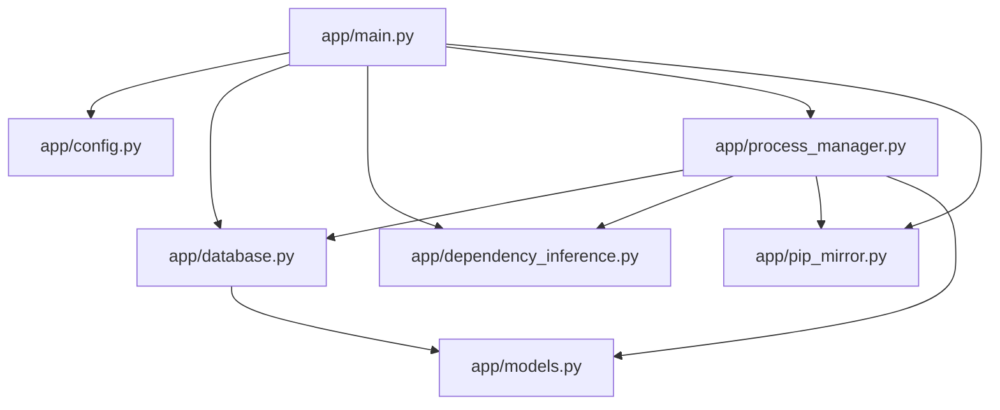
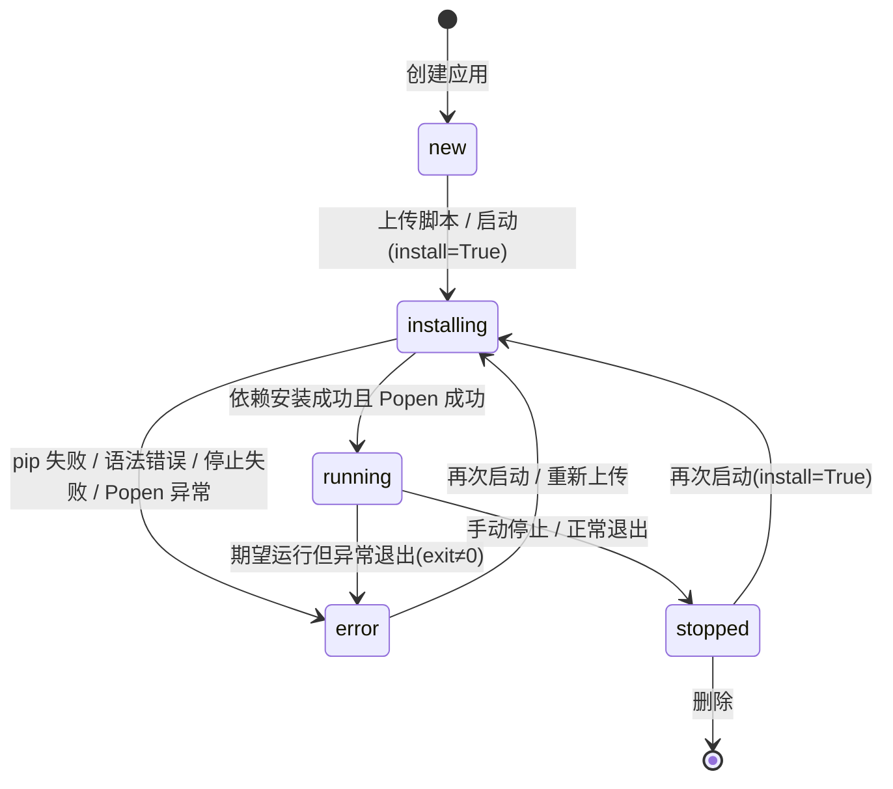

# 01 · 架构总览

## 1. 定位与目标

本项目是一个**内部运维工具**：让可信管理员通过浏览器上传若干 Python 脚本，并由平台统一完成“建虚拟环境 → 装依赖 → 常驻运行 → 查看日志 / 停止 / 重启 / 删除 / 开机恢复”的闭环。它不是一个多租户的 PaaS，也不是代码沙箱。

关键约束来自 README 与代码：

- 单管理员、密码登录（`admin_password`）。
- 每个应用拥有独立的虚拟环境、工作目录、日志文件与进程。
- 上传后**自动重启该应用**，不提供版本管理/回滚。
- 上传代码与平台进程同机、同用户运行。

## 2. 技术栈

| 层次 | 技术 | 说明 |
| --- | --- | --- |
| Web 框架 | FastAPI `>=0.111` | 路由、依赖注入（`Depends`）、异常处理器 |
| ASGI 服务器 | Uvicorn `>=0.30` | `uvicorn app.main:app` |
| 会话 | Starlette `SessionMiddleware` | Cookie 签名会话，`itsdangerous` 提供签名 |
| 模板 | — | 不再使用服务端模板，改由 SPA 渲染 |
| 前端 | React 18 + TypeScript + Vite + Tailwind CSS | 独立 SPA，构建产物由 FastAPI 托管 |
| 前端状态 | React Router + TanStack Query | 客户端路由、服务端状态缓存与轮询 |
| 表单/上传 | `python-multipart` | `Form(...)`、`UploadFile` |
| 持久化 | 标准库 `sqlite3` | 无 ORM，手写 SQL |
| 配置 | 标准库 `tomllib` | `config.toml` |
| 进程控制 | `subprocess` + `os.killpg` + `signal` | 独立进程组，SIGTERM → SIGKILL |
| 依赖解析 | 标准库 `ast` | 静态分析 `import` 语句 |
| 测试 | `pytest` + `httpx2`（`TestClient` 依赖） | 见 `pyproject.toml [project.optional-dependencies].dev` |

## 3. 运行时拓扑

```text
┌──────────────────────────── 单个 OS 进程（uvicorn） ────────────────────────────┐
│                                                                                │
│  FastAPI app (app/main.py)                                                     │
│   ├── SessionMiddleware        ← 签名 Cookie 保存 authenticated 标记             │
│   ├── JSON API /api/auth/*、/api/apps/*、/api/settings                          │
│   ├── SPA 托管 /static/app/* + 兜底路由返回 index.html                          │
│   └── 上传后启动后台线程 _process_uploaded_script                                 │
│                                                                                │
│  ProcessManager (app/process_manager.py)   ← 进程内单例，threading.RLock 串行化   │
│   ├── processes: dict[app_id, Popen]        ← 仅记录本进程启动的子进程            │
│   ├── 每个应用一个守护线程 _watch_process                                        │
│   └── restore_desired() / shutdown() 由 lifespan 调用                            │
│                                                                                │
│  AppRepository (app/database.py)  →  SQLite 文件 <data_dir>/manager.db          │
└────────────────────────────────────────────────────────────────────────────────┘
             │ Popen(start_new_session=True)
             ▼
┌──────────────────────── data/apps/<slug>/ ────────────────────────┐
│  main.py            上传的脚本（固定文件名）                         │
│  .venv/             该应用专属虚拟环境                              │
│  install.log        虚拟环境创建 + pip 安装日志                      │
│  runtime.log        应用 stdout/stderr（追加写入）                   │
│  .pending-upload-*  上传过程中的临时文件（处理完删除）               │
└───────────────────────────────────────────────────────────────────┘
```

## 4. 代码分层

项目刻意保持“薄分层”，共 5 个可替换边界：

| 层 | 文件 | 职责 | 不应做的事 |
| --- | --- | --- | --- |
| 配置层 | `config.py` | 解析 TOML，产出不可变 `Settings` | 不碰数据库/进程 |
| 模型层 | `models.py` | `ManagedApp` 只读数据载体 + 派生属性 | 不含 I/O |
| 持久化层 | `database.py` | 建表、迁移、CRUD 与设置项读写 | 不启动进程 |
| 领域/运行时层 | `process_manager.py`、`dependency_inference.py`、`pip_mirror.py` | 进程生命周期、依赖推断、镜像参数 | 不依赖 FastAPI |
| 接入层 | `main.py` + `static/` + `frontend/` | HTTP 路由、鉴权、JSON API、SPA 托管 | 不直接 spawn 进程（委托 `ProcessManager`） |

依赖方向是单向的：



- `main.py` 是唯一装配点（composition root）：模块导入时即创建 `settings`、`repo`、`manager` 三个全局单例。
- `process_manager.py` 依赖最广（数据库、依赖推断、镜像、模型），但**不导入 `main.py`**，可脱离 Web 层单测（`tests/test_process_manager.py` 即如此）。
- `models.py`、`dependency_inference.py`、`pip_mirror.py` 均为低依赖纯逻辑/纯数据模块。

## 5. 两条核心数据流

### 5.1 读请求（页面/状态）

```text
GET /apps/1（浏览器直接访问或刷新）
  → 非 /api、/static 路径命中 SPA 兜底路由 → 返回 app/static/app/index.html
  → React Router 渲染 DashboardPage
  → 前端调用 GET /api/apps 与 GET /api/apps/1（每 2.5–4 秒轮询）
        → require_auth（未登录 401 JSON → 前端跳转 /login）
        → repo.get_app(id) / repo.list_apps()      （每次新建 sqlite3 连接）
        → manager.read_log_tail(app)                （读 install.log + runtime.log 尾部各 20KB）
```

### 5.2 写请求（上传并重启）

```text
POST /api/apps/1/upload  (multipart: file, manual_dependencies)
  → 校验 .py 后缀
  → 写入 <app_dir>/.pending-upload-<uuid>.py
  → repo.set_progress(stage=upload_received, 25)
  → 启动 daemon 线程 _process_uploaded_script 并立即返回 {"accepted": true}
        └─ 线程内（持有 manager.lock）
           停止旧进程 → status=installing → AST 推断依赖
           → 覆盖 main.py → 写库 → manager.start(install=True)
               └─ 建 venv → pip install → Popen → status=running + 守护线程
```

设计动机：上传/安装可能耗时数十秒，不能阻塞 HTTP 响应；前端通过 `progress` 字段轮询获得反馈，同时用 XHR 展示浏览器到服务端的传输进度。代价是“进程内线程 + SQLite 进度字段”这一组合不具备跨进程分发能力。

## 6. 应用状态机

`managed_apps.status` 的取值与迁移关系（由路由与 `ProcessManager` 共同写入）：



关于 `starting`：只有 `start(install=False)`（即启动恢复）时会短暂把状态写为 `starting`，随后立即变为 `running`；正常启动路径的状态一直是 `installing`，`starting` 仅作为**进度阶段**（90%）出现。前端状态标签仍保留 `starting` 映射。

相关字段：`desired_running`（重启后是否应恢复）、`pid`、`last_error`、`progress_stage/percent/message`。

## 7. 关键设计取舍

1. **无 ORM**：两张表，手写 SQL 更直接；`set_progress` 在写入前做 0–100 截断。
2. **轻量迁移**：`_ensure_column` 通过 `PRAGMA table_info` 检测列并 `ALTER TABLE ADD COLUMN`，兼容旧库（见 `tests/test_database.py`）。
3. **固定脚本名**：上传内容一律保存为 `main.py`，不信任用户文件名，避免路径穿越；下载时用数据库里的 `script_name` 作为呈现名。
4. **进程组管理**：`Popen(start_new_session=True)` 让子进程成为新会话/进程组首领，停止时 `os.killpg` 可一并清理脚本派生的子进程。
5. **持久化恢复**：`shutdown()` 停止进程但保留 `desired_running=True`；下次 `lifespan` 启动时 `restore_desired()` 以 `install=False` 拉起，避免每次重启重复装依赖。
6. **锁的粒度**：`ProcessManager.lock` 为 `RLock`，覆盖 start/stop/上传处理；上传线程与路由中的 start/stop 会串行执行，避免同一应用被并发操作。

## 8. 部署形态

- **本地**：`python -m venv` + `pip install -e .` + `config.toml` + `uvicorn app.main:app`。
- **Docker**：`python:3.13-slim`，额外安装 `python3-venv`（运行期要建 venv），以非 root 用户 `manager` 运行，`/app/data` 为数据目录。
- **生产 Compose**：`network_mode: host`，挂载只读 `config.toml` 与命名卷 `python-manager-data:/app/data`，`stop_grace_period: 60s` 给停止子进程留时间。

细节见 [07 配置、运行与部署](07-configuration-deployment.md)。
