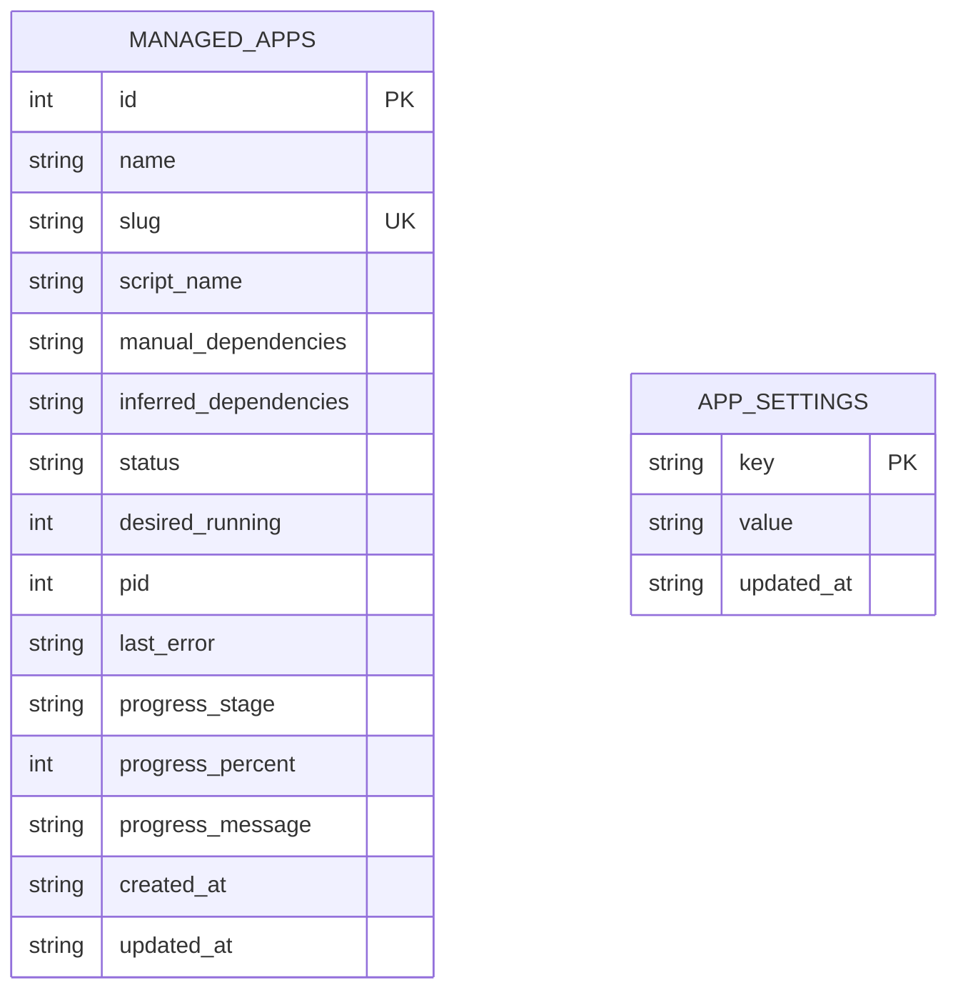

# 03 · 数据模型与持久化

数据层只有一个 SQLite 文件：`<data_dir>/manager.db`（默认 `./data/manager.db`）。没有 ORM、没有迁移框架，schema 由 [`app/database.py`](../../app/database.py) 的 `AppRepository.init_schema()` 在每次实例化时幂等执行。

## 1. 表结构

### 1.1 `managed_apps`

```sql
CREATE TABLE IF NOT EXISTS managed_apps (
    id INTEGER PRIMARY KEY AUTOINCREMENT,
    name TEXT NOT NULL,
    slug TEXT NOT NULL UNIQUE,
    script_name TEXT,
    manual_dependencies TEXT NOT NULL DEFAULT '',
    inferred_dependencies TEXT NOT NULL DEFAULT '',
    status TEXT NOT NULL DEFAULT 'new',
    desired_running INTEGER NOT NULL DEFAULT 0,
    pid INTEGER,
    last_error TEXT NOT NULL DEFAULT '',
    progress_stage TEXT NOT NULL DEFAULT 'idle',
    progress_percent INTEGER NOT NULL DEFAULT 0,
    progress_message TEXT NOT NULL DEFAULT '',
    created_at TEXT NOT NULL DEFAULT CURRENT_TIMESTAMP,
    updated_at TEXT NOT NULL DEFAULT CURRENT_TIMESTAMP
);
```

### 1.2 `app_settings`

```sql
CREATE TABLE IF NOT EXISTS app_settings (
    key TEXT PRIMARY KEY,
    value TEXT NOT NULL DEFAULT '',
    updated_at TEXT NOT NULL DEFAULT CURRENT_TIMESTAMP
);
```

用于保存系统级配置（当前只有 pip 镜像源两个 key），与 `config.toml` 的静态配置分开：前者可在线修改，后者需重启。

## 2. 字段语义

| 字段 | 类型 | 含义 | 谁写入 |
| --- | --- | --- | --- |
| `id` | INTEGER | 自增主键，路由与 API 的唯一标识 | SQLite |
| `name` | TEXT | 展示名称，用户输入（去首尾空白） | `create_app` |
| `slug` | TEXT | 目录名与唯一键，由 `slugify(name)` 生成 | `create_app` |
| `script_name` | TEXT? | 展示/下载用文件名，实际上传统一写 `"main.py"` | `update_upload` |
| `manual_dependencies` | TEXT | 用户输入的多行依赖原文（含版本约束） | `update_upload` |
| `inferred_dependencies` | TEXT | 推断结果，每行一个包名 | `update_upload` |
| `status` | TEXT | 生命周期状态，见下表 | `set_status` |
| `desired_running` | INTEGER(0/1) | 期望状态；决定重启后是否自动恢复 | `set_desired_running` |
| `pid` | INTEGER? | 子进程（= 进程组）ID；停止后置 `NULL` | `set_status` |
| `last_error` | TEXT | 最近一次失败原因；成功操作会清空 | `set_status` / `update_upload` |
| `progress_stage` | TEXT | 进度阶段标识 | `set_progress` |
| `progress_percent` | INTEGER | 0–100，写入前截断 | `set_progress` |
| `progress_message` | TEXT | 中文进度提示 | `set_progress` |
| `created_at` | TEXT | `CURRENT_TIMESTAMP`（UTC 文本） | SQLite 默认值 |
| `updated_at` | TEXT | 每次写入显式更新 | 各 update 语句 |

### 状态与进度取值

| `status` | 含义 | 典型迁移 |
| --- | --- | --- |
| `new` | 刚创建、未上传 | → `installing` |
| `installing` | 正在建 venv / 装依赖，随后直接启动 | → `running` / `error` |
| `starting` | 仅 `start(install=False)` 启动恢复时短暂出现 | → `running` / `error` |
| `running` | 子进程存活 | → `stopped` / `error` |
| `stopped` | 已停止（手动或正常退出） | → `installing` |
| `error` | 失败（装依赖、语法、启动、异常退出） | → `installing` |

| `progress_stage` | percent | 触发点 |
| --- | --- | --- |
| `idle` | 0 | 初始 / 停止后（`reset_progress=True`） |
| `upload_received` | 25 | 上传落盘完成 |
| `parsing` | 35 | 开始 AST 解析 |
| `venv` | 45 | 创建/确认虚拟环境 |
| `installing` | 70（有依赖）/ 80（无依赖） | pip 安装阶段 |
| `starting` | 90 | 即将 `Popen` |
| `complete` | 100 | 启动成功 |
| `failed` | 100 | 任一失败路径 |

> `progress_message` 为面向中文用户的提示；前端在 `progress_message` 非空时显示进度块。

## 3. `ManagedApp` 模型映射

[`app/models.py`](../../app/models.py) 的冻结 dataclass 与表字段一一对应，并额外提供：

- `inferred_list` → `inferred_dependencies.splitlines()` 去空行
- `manual_list` → `manual_dependencies.splitlines()` 去空行

映射由 `AppRepository._row_to_app()` 完成，负责 `int()/str()/bool()` 转换。由于是 frozen dataclass，任何更新都必须“写库 → 重新 `get_app`”获取新快照，而不是原地修改对象。

## 4. 关系



两张表之间无外键关系：设置项是全局的，被所有应用共享。

### 设置项键

| key | 取值 | 说明 |
| --- | --- | --- |
| `pip_index_selector` | `official` / `tsinghua` / `aliyun` / `tencent` / `ustc` / `custom` | 当前选中的镜像预设 |
| `pip_index_url` | URL 或空串 | 实际传给 pip 的 index URL；`official` 时为官方源 |

## 5. 文件系统与数据库的一致性

数据库只存元数据，真实内容在磁盘：

| 数据 | 位置 | 一致性策略 |
| --- | --- | --- |
| 脚本 | `<data_dir>/apps/<slug>/main.py` | 上传先用临时名，成功后 `Path.replace` 原子覆盖 |
| venv | `<data_dir>/apps/<slug>/.venv/` | 存在即复用；`delete` 时随目录 `rmtree` |
| 日志 | `install.log`、`runtime.log` | 追加写，不轮转；只读尾部 20KB |
| 记录 | `manager.db` | 先停进程再删文件，最后删记录（`ProcessManager.delete`） |

`delete_app` 只删数据库行；删除目录的逻辑在 `ProcessManager.delete`，顺序为 **stop → rmtree → delete row**，因此停止失败时不会出现“记录还在但文件没了”的半删除状态。

## 6. 迁移机制

```python
columns = {row["name"] for row in conn.execute("PRAGMA table_info(managed_apps)")}
if column not in columns:
    conn.execute(f"ALTER TABLE managed_apps ADD COLUMN {column} {definition}")
```

- 启动时对 `progress_stage`、`progress_percent`、`progress_message` 三列做“缺列补列”。
- 只向前兼容，不处理类型变更、不删列、不重命名。
- `tests/test_database.py::test_existing_database_is_migrated_with_progress_defaults` 用一个不含 progress 列的旧表验证该路径。
- 新增字段时的正确做法：在 `CREATE TABLE` 里加列，同时在 `init_schema()` 里追加一次 `_ensure_column`，并补一条迁移测试。

## 7. 连接与事务

- 每个方法新建连接（`AppRepository.connect()`），`with` 语句结束自动 commit/rollback 并关闭。
- 未开启 WAL，亦未设置 `check_same_thread`；由于每次操作独立连接，多线程（上传线程 + 请求线程）访问是安全的，但高并发写会有锁竞争，SQLite 默认会等待。
- `set_progress` 的百分比在 Python 侧截断，避免非法值进入库。
