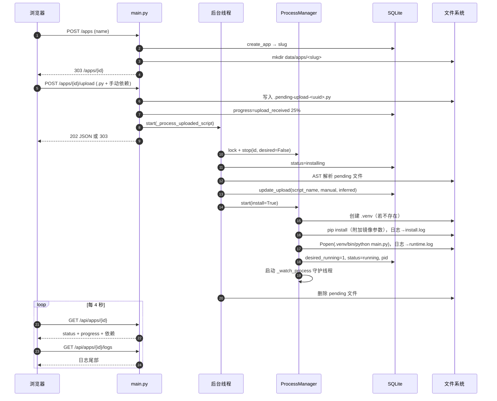
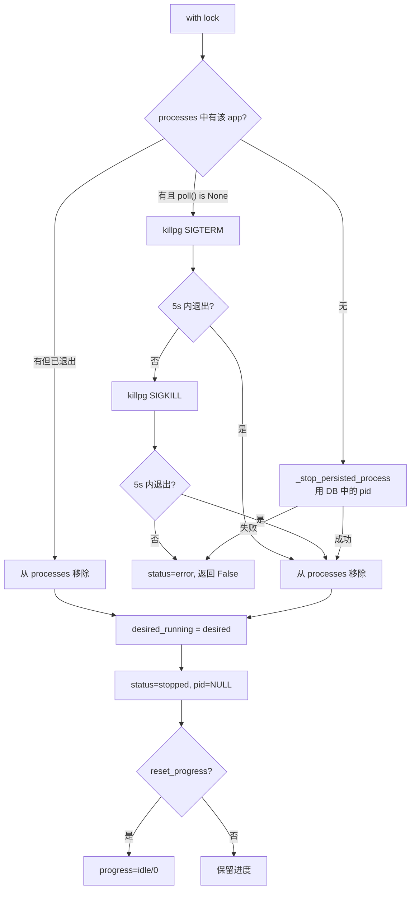

# 04 · 应用生命周期与进程管理

本文描述一个受管应用从创建到删除的完整过程，以及 `ProcessManager` 如何启动、停止与恢复进程。对应代码：[`app/process_manager.py`](../../app/process_manager.py)、[`app/main.py`](../../app/main.py)。

## 1. 生命周期总览



## 2. 创建应用

`POST /api/apps`（JSON 字段 `name`）：

1. 名称 `strip()` 为空 → 400。
2. `repo.create_app(name)`：`slugify` 生成 slug；若冲突则尝试 `<slug>-2`、`<slug>-3`…（`create_app` 内 `while` 查询）。
3. `manager.app_dir(created)` 立即创建 `data/apps/<slug>/`。
4. 返回 201 + `ManagedApp` JSON，前端导航到 `/apps/{id}`。

此时状态为 `new`，`script_name` 为空。

## 3. 上传处理流水线

入口 `POST /api/apps/{id}/upload`（`multipart/form-data`）：

1. 校验应用存在、文件后缀为 `.py`（仅检查 `file.filename`，大小写敏感）。
2. 保存到 `<app_dir>/.pending-upload-<uuid4>.py`。
3. `repo.set_progress(app_id, "upload_received", 25, "上传完成，等待处理...")`。
4. 启动 `daemon=True` 线程 `_process_uploaded_script`，**立即返回** `{"accepted": true, "app_id": id}`。

后台线程内部（`with manager.lock`）：

| 步骤 | 代码 | 失败处理 |
| --- | --- | --- |
| 1. 停止当前应用 | `manager.stop(app_id, desired=False, reset_progress=False)` | 返回 False → `failed/100%`，**不覆盖原脚本**，直接 return |
| 2. 标记安装中 | `repo.set_status(app_id, "installing", pid=None)` | — |
| 3. 解析依赖 | `infer_dependencies(pending_path)` | `SyntaxError` → 状态 `error` + `failed/100%` |
| 4. 落盘覆盖 | `pending_path.replace(script_path)`（同一文件系统内原子替换） | 通用 `Exception` → `error` + `failed/100%` |
| 5. 写库 | `repo.update_upload(app_id, "main.py", manual_dependencies, inferred)` | 同上 |
| 6. 安装并启动 | `manager.start(app_id, install=True, progress=progress)` | 由 `start`/`install_dependencies` 自行写 `error` |
| 7. finally | 若临时文件仍存在则删除 | — |

`progress` 回调贯穿 3–6 步，把 `parsing/35%`、`venv/45%`、`installing/70%`、`starting/90%`、`complete/100%` 写入数据库，前端轮询即可看到条状进度。

> 注意：手动依赖的**文本原文**被保存，推断结果单独保存；实际安装时由 `merge_dependencies` 合并（手动优先，按包名去重）。

## 4. 启动流程 `ProcessManager.start`

```
start(app_id, install=True, progress=None)
├─ progress 为空时，默认回调 = repo.set_progress(app_id, ...)
├─ _require_app(app_id)                       # 不存在抛 ValueError
├─ script_path 不存在?
│    → status=error("Upload a Python file before starting.")
│    → progress=failed/100%
│    → return
└─ with self.lock:
     ├─ stop(app_id, desired=False, reset_progress=False)
     │    └─ 失败 → desired=0, progress=failed/100%, return
     ├─ repo.set_status(app_id, "installing" if install else "starting")
     ├─ install_dependencies(app, progress)
     │    └─ 失败 → desired=0, return（install_dependencies 已写 error）
     ├─ progress="starting"/90%
     ├─ 打开 runtime.log（'ab'，无缓冲）
     ├─ Popen([venv_python, script_path], cwd=app_dir,
     │         stdout=log, stderr=STDOUT, start_new_session=True)
     │    └─ 异常 → 写日志、desired=0、status=error、failed/100%
     ├─ processes[app_id] = process
     ├─ desired_running=1, status=running, pid=process.pid
     ├─ progress=complete/100%
     └─ 启动 _watch_process 守护线程
```

要点：

- **先停后起**：同一应用不会并发运行两份；`start` 同时承担 `restart` 语义。
- **install=False** 用于启动恢复：跳过 pip，直接起进程，但仍会校验 venv 与脚本路径。
- `cwd` 固定为应用目录，脚本内的相对路径读写都发生在自己的沙箱目录（非安全沙箱，仅作隔离）。
- `start_new_session=True` 使子进程成为新会话首领，其 pid 即进程组 id，便于 `killpg`。

## 5. 依赖安装 `install_dependencies`

```
merge_dependencies(app.inferred_list, app.manual_dependencies)
→ 打开 install.log (append)
→ 若 .venv/bin/python 不存在:
      progress=venv/45%
      subprocess.run([sys.executable, "-m", "venv", .venv], check=True, 输出→install.log)
→ 若有依赖:
      progress=installing/70%
      cmd = [venv_python, "-m", "pip", "install", *deps]
      cmd += build_pip_index_args(repo.get_setting("pip_index_url", ""))
      subprocess.run(cmd, check=True, 输出→install.log)
→ 无依赖:
      progress=installing/80% "没有需要安装的依赖。"
```

失败语义：`CalledProcessError` / `OSError` → `status=error`、`last_error` 写明原因（含退出码）、`progress=failed/100%`、返回 `False`，并**不启动进程**。

注意 pip 安装是同步阻塞调用，运行在请求线程（`/start`）或上传后台线程中。

## 6. 停止流程 `stop(app_id, desired=False, reset_progress=True)`



异常分类：

| 异常 | 处理 |
| --- | --- |
| `ProcessLookupError` | 进程/进程组已不存在 → 视为成功 |
| `PermissionError` | 写 `error`（含 pid）并返回 `False` |
| `TimeoutExpired`（两次） | 写 `error` "Timed out stopping process group" 并返回 `False` |

`desired` 参数的含义：

- 手动停止 / 上传前停止 / 删除：`desired=False`，重启后**不**恢复。
- `shutdown()`：`desired=True`，重启后**恢复**。

## 7. 残留进程兜底 `_stop_persisted_process`

服务进程重启后，`processes` 字典为空，但数据库 `pid` 可能指向仍在运行的应用：

1. 无 pid → 直接成功。
2. `os.killpg(pid, SIGTERM)`；`ProcessLookupError` → 成功；`PermissionError` → 记错误并失败。
3. `os.waitpid(pid, 0)` 成功 → 成功（本进程是该子进程的父进程）。
4. 否则（孤儿进程，`ChildProcessError`）→ 每 0.1s `killpg(pid, 0)` 探测，最多 50 次（约 5s）。
5. 仍未消失 → `SIGKILL` 进程组；`ProcessLookupError` 视为成功。

这一步依赖“pid 即进程组 id”的约定（由 `start_new_session=True` 保证），因此旧进程的整个进程树会被清理。

> 风险提示：如果数据库中残留的 pid 已被操作系统复用给无关进程，`killpg` 可能误伤同 id 的进程组。当前实现没有校验 `/proc/<pid>` 的命令行，故建议避免手动改写 `pid` 字段，并在异常停机后优先核对进程归属。

## 8. 进程守护 `_watch_process`

每个启动的应用有一个守护线程阻塞在 `process.wait()`：

```python
code = process.wait()
with self.lock:
    if self.processes.get(app_id) is process:     # 防止已被新进程替换时误写
        self.processes.pop(app_id)
        desired = repo.get_app(app_id).desired_running
        status = "error" if desired and code != 0 else "stopped"
        repo.set_status(app_id, status, f"Process exited with code {code}" if code else "", pid=None)
        # error → progress=failed/100%；desired 下正常退出 → idle/0
```

- 判定规则：**期望运行**（`desired_running=1`）且退出码非 0 → `error`；否则 `stopped`。
- 不自动重启（无 supervisor 策略），需要用户手动点“启动”或重新上传。
- `is process` 判断避免“旧进程退出事件”覆盖“新进程启动状态”。

## 9. 启动恢复与优雅关闭

`app/main.py` 的 `lifespan`：

```python
@asynccontextmanager
async def lifespan(_: FastAPI):
    manager.restore_desired()
    try:
        yield
    finally:
        manager.shutdown()
```

- **restore_desired**：遍历所有 `desired_running=1` 的应用，`start(install=False)`；异常被捕获并写 `error("Restore failed: ...")`，不会阻断其他应用或服务启动。
- **shutdown**：对 `processes` 中每个 app 调 `stop(desired=True, reset_progress=False)`，保留“期望运行”标记与进度，供下次启动恢复。

因此重启平台的效果是：正在运行的应用会被短暂终止并重新拉起（依赖不重装）。

> 注意：恢复路径 `install=False` 不会创建 venv，也不会执行 pip。如果应用目录或 `.venv` 被手动删除，恢复会在 `Popen` 阶段失败并写入 `status=error` / `"App start failed: ..."`，需要在页面上点一次“启动/重启”（`install=True`）重建环境。

## 10. 删除

`ProcessManager.delete(app_id)`：

1. `stop(app_id, desired=False)`；失败则直接返回，**不删文件、不删记录**。
2. `shutil.rmtree(app_dir, ignore_errors=True)` 删除脚本、venv、日志。
3. `repo.delete_app(app_id)` 删除数据库行。

## 11. 日志

| 日志 | 写入者 | 内容 |
| --- | --- | --- |
| `install.log` | `install_dependencies` 的 `stdout=log, stderr=STDOUT` | venv 创建、pip 解析/下载/安装输出、失败信息 |
| `runtime.log` | `Popen(stdout=log_file, stderr=STDOUT)` | 脚本自身的 stdout/stderr；启动失败时的 `App start failed: ...` |

`read_log_tail(app, limit=20000)`：依次读取两个文件各自最后 20,000 字节，UTF-8 `errors="replace"` 解码，用换行拼接并 `strip()`。SPA 通过 `/api/apps/{id}/logs` 获取，默认每 4 秒轮询。

## 12. 并发模型小结

| 线程 | 触发 | 持锁? |
| --- | --- | --- |
| HTTP 请求线程 | 路由处理（start/stop/restart/delete/settings） | `start`/`stop`/`delete` 内部持锁 |
| 上传处理线程 | 每次上传一个 daemon 线程 | 整段持锁 |
| 进程守护线程 | 每个运行中应用一个 | 写状态时持锁（阻塞 `wait()` 时不持锁） |
| 事件循环 | FastAPI/uvicorn | — |

风险提示：同步阻塞操作（pip 安装、`process.wait` 之外的 5s 等待）运行在线程池或后台线程中；`start` 若从 API 路由触发，会占用一个同步工作线程直到安装结束。这是当前实现的已知特性，而非缺陷修复项。
